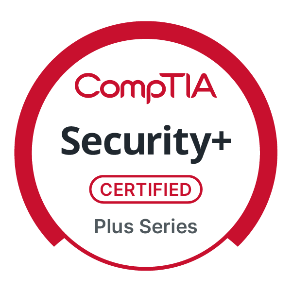

# <a href="https://www.linkedin.com/">Sammy Tetzba</a>'s IT and Cybersecurity Project Portfolio 🔐

I’m passionate about cybersecurity and focused on building practical, hands-on experience through projects that reflect real-world security challenges. My work explores areas such as threat detection, incident response, security monitoring, phishing awareness, and cloud security. Through these projects, I continue to strengthen my technical skills, sharpen my investigative mindset, and develop a deeper understanding of how security teams identify, analyze, and respond to threats. Feel free to explore my projects and see how I’m applying what I’ve learned to practical cybersecurity scenarios.

## 🏅 Certifications

**CompTIA Security+** | Microsoft Azure Fundamentals (AZ-900)
  

---

## ⚠️ Vulnerability Management Projects

- [**Vulnerability Management Program Implementation**](https://github.com/TetsaLab/Vulnerability-Management-Program/blob/main/README.md)
- [**Programmatic Vulnerability Remediations (PowerShell, BASH, & Shell Commands)**](https://github.com/TetsaLab/Programmatic-Vulnerability-Remediations-PowerShell-BASH-Shell-Commands-/blob/main/README.md)
- [**Vulnerability Management and STIG Remediation with Tenable**](https://github.com/TetsaLab/Vulnerability-Management-Tenable-Demo)

## 🚨 Threat Hunting and Security Operations

- [**Live Incident Response Honeypot Lab**](https://github.com/TetsaLab/Live-Incident-and-Response-Honeypot-Project)
- [**Threat Hunting Investigation: Unauthorized Tor Browser Usage**](https://github.com/TetsaLab/threat-hunting-scenario-tor/blob/main/README.md)

## 🎣 Phishing Simulation & Security Awareness

- [**Phishing Simulation Lab: Gophish, Mailpit & Security Awareness Testing**](https://github.com/TetsaLab/Phishing-Simulator)

---

*All projects are conducted in controlled lab environments for educational purposes, technical skill development, and cybersecurity portfolio demonstration.*

